<!--
  StigmaAU · Project Reborn RP developer HQ
  Every image in assets/ is generated: edit assets/src and run `python assets/src/build.py`.
  assets/telemetry.svg is redrawn daily from GitHub data by .github/workflows/telemetry.yml.
-->

  

  

  

  I build the systems behind <b>Project Reborn RP</b>, an Australian, NSW-inspired FiveM roleplay server:
  staff tools, skills and crafting, vehicle dealerships and the design system behind every screen.

  

  

  

  

  

  

  

  

  

  

  

  

  

  

